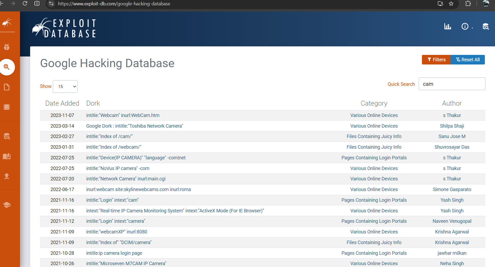
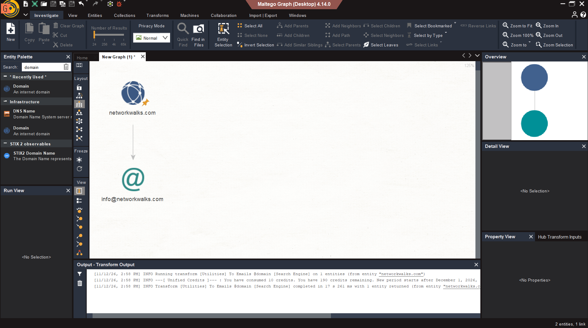
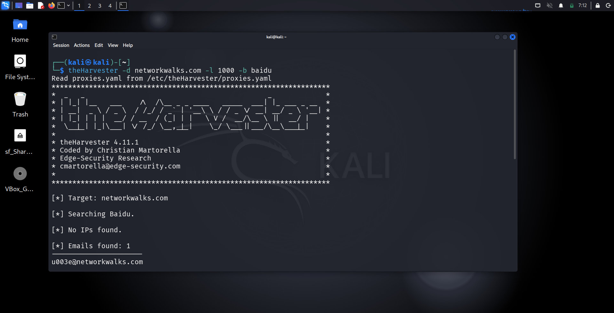
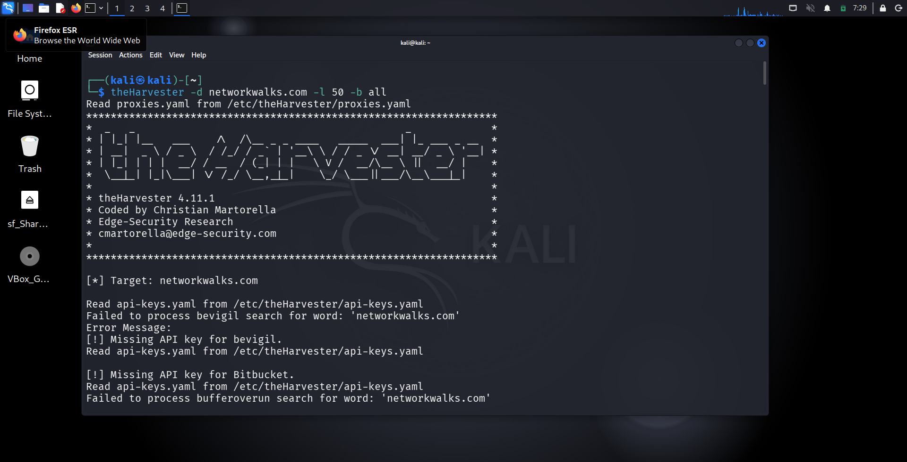
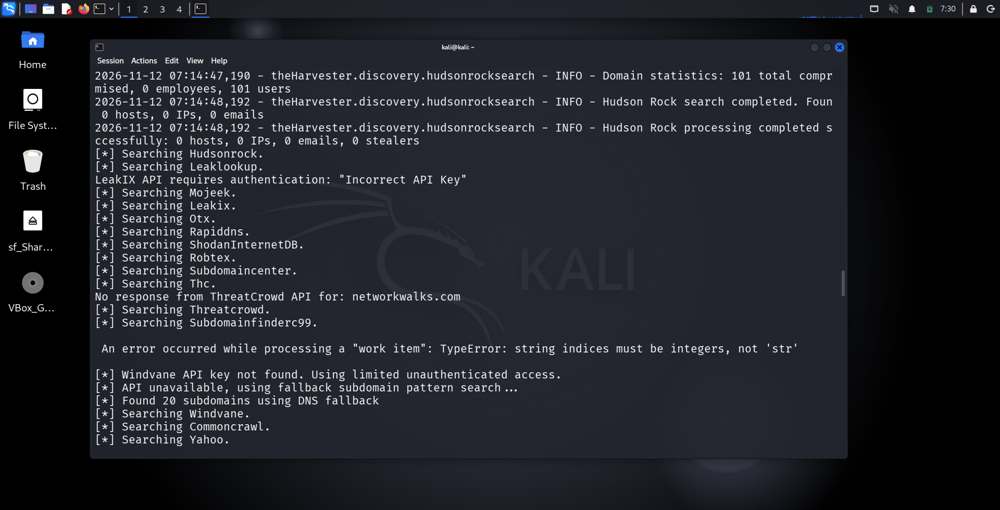
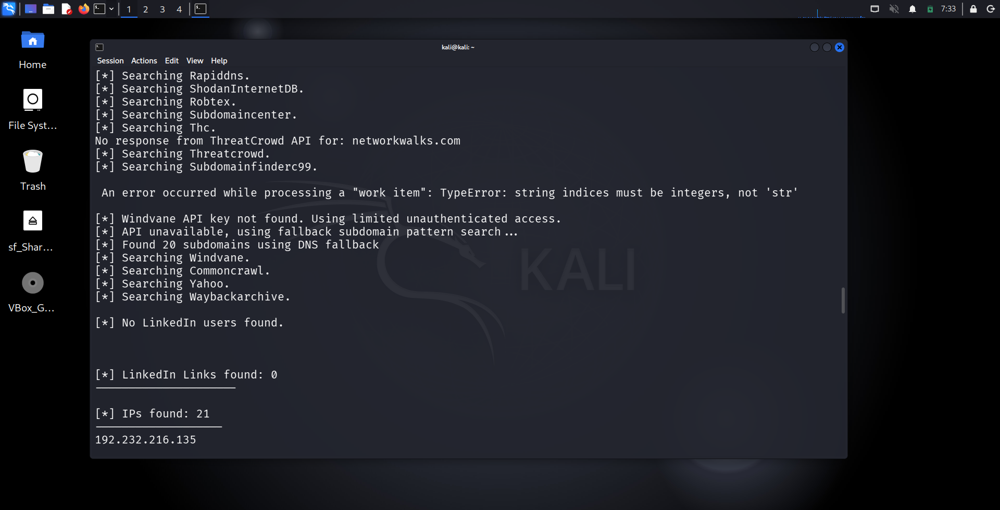
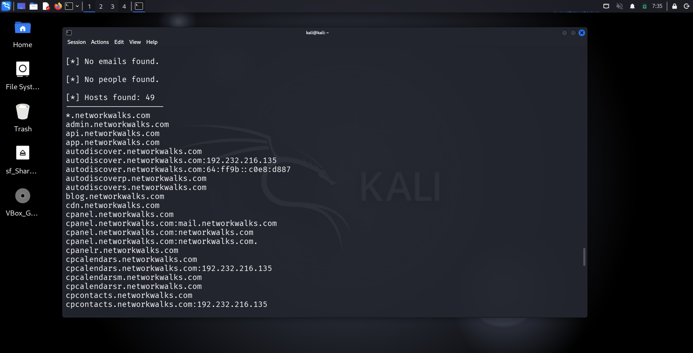
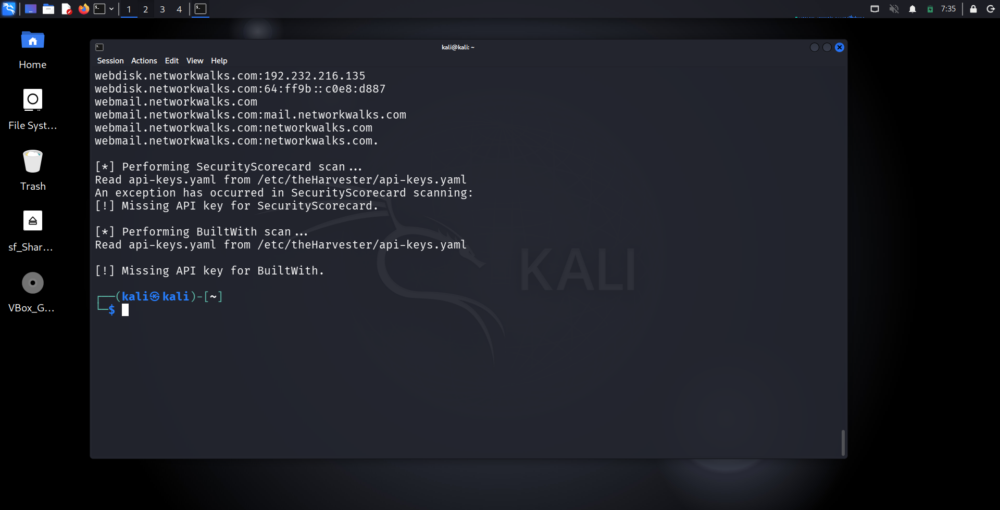

# Networkwalks-B084-week2-Footprinting-Extra
### Passive Reconnaissance Tools 

**W2-EXTRA  |  CYBERSECURITY  |  NETWORKWALKS**

| Field | Detail |
|---|---|
| **Pentester Name (Cybersecurity Professional)** | **Ebenezer Twumasi Frimpong** |
| **Program/Batch** | B084-Networkwalks |
| **Date** | 11 November 2026 |
| **Modules completed** | W2-PM2 (GHDB) W2-PM2 (Maltego) W2-PM4 (theHarvester) |
| **Client/Target** | Networkwalks (secured written permission already) |
| **Permission secured from client?** | Yes |
| **Phase covered** | **Phase 1:** Reconnaissance & Footprinting |

# 1. Liability Disclaimer

I have performed these activities only on the systems & devices where I had secured written permission or the devices/systems that I own myself. All these materials are for education and research purpose only. Do not use anything from here to break the law. The instructor, the authors and Networkwalks are not responsible for what you do with this knowledge. Every action you take is your own responsibility. Misuse can lead to criminal charges, heavy fines, loss of your job and a permanent record. In most countries unauthorised access is a crime even when nothing is damaged.

# 2. Introduction

Footprinting and reconnaissance are essential stages of penetration testing. They involve gathering information about a target organization, its digital infrastructure, network presence, employees, domains as well as publicly accessible resources. The purpose of this phase is to understand the target's digital footprint and identify potential security vulnerabilities that may be exploited or otherwise investigated during subsequent penetration testing activities.

During this reconnaissance exercise, 3 information-gathering tools were utilized: Google Hacking Database (GHDB), Maltego and theHarvester. These tools were used to collect publicly available information through Open-Source Intelligence (OSINT) techniques. Each tool provides a different approach to reconnaissance, allowing the me to gather, analyze and correlate information about the target

# 3. Tools Used

The table below lists each tool used in this report and its purpose.

| Tool | Purpose |
|---|---|
| GHDB          | Discover publicly exposed sensitive information.          |
| Maltego       | Visualize relationships between target or digital assets. |
| theHarvester  | Collect emails, subdomains and hostnames.                |

# 4. Tools Used for Reconnaissance

## 4.1 Google Hacking Database (GHDB)

I used GHDB as a reference for identifying 10x live vulnerable camara links that are exposed and accessible from the internet as well as 10x downloadable mathematics ebooks in PDF format. Other search queries techniques such as the underlisted can be used:

1.	**site**: Restricts search results to a particular website or domain.
2.	**filetype**: Identifies specific file types such as PDF, DOCX, XLSX and TXT.
3.	**intitle**: Searches for specific words appearing in webpage titles.
4.	**inurl**: Identifies webpages containing particular terms in their URLs.

GHDB is valuable because it provides a quick and relatively non-intrusive way to identify publicly indexed information and potential information disclosure issues without directly scanning or interacting with the target's internal network. 

## 4.2 Maltego

I used Maltego to gather and visualize information related to `networkwalks.com` such as its email address. By entering the target's domain name (networkwalks.com), Maltego can perform transformations to discover related entities and relationships. The information gathered is presented in a graphical format, where individual entities are represented as nodes and their relationships are represented by connecting lines. This visualization makes it easier to understand how different components of the target's online infrastructure are interconnected.

Maltego is important because it transforms individual pieces of publicly available information into a visual representation of the target's digital infrastructure. This helps pentesters identify relationships and potential areas of exposure that may not be obvious when information is examined separately.

## 4.3 theHarvester

I used theHarvester to search for public information related to `networkwalks.com`. First, I used the tool to find email IDs and sub-domains with **baidu** as the source while setting the results limit to 1000. Again, I used the **all** option which request all supported sources available in the install version which provided information that could be relevant to assessing phishing exposure and account security risks. 

theHarvester is valuable because it provides a relatively fast way to collect and organize publicly available information about a target. It helps pentesters establish an initial understanding of the organization's digital footprint and identify additional assets for further investigation.

# 5. Importance of Reconnaissance in Penetration Testing

Reconnaissance is important because it provides the foundation for the subsequent stages of penetration testing. The information collected using these tools can assist pentesters as follows:

1. Identifying the organization's publicly accessible digital assets.

2. Understanding the target's internet-facing infrastructure.

3. Discovering potentially exposed information and misconfigurations.

4. Identifying possible entry points that require further security assessment.

5. Reducing unnecessary testing by focusing on relevant and authorized assets.

6. Developing a clearer picture of the organization's overall attack surface.

# 6. Recommendations

Based on the reconnaissance activities performed, I recommend the following:

1.  Regularly review publicly accessible files and remove sensitive information that should not be exposed.

2.  Ensure that administrative interfaces are properly secured and not unnecessarily exposed.

3.  Maintain an updated inventory of domains, subdomains and internet-facing assets.

4.  Review publicly exposed employee email addresses and strengthen email security controls.

5.  Regularly assess DNS records and external infrastructure for misconfigurations.

6.  Conduct periodic penetration testing and vulnerability assessments.

7.  Establish policies for managing and protecting organizational information published online.

# 7. Conclusion

During Week 2 of my Cybersecurity & Ethical Hacking internship, I completed practical activities covering footprinting and reconnaissance demonstrating how different OSINT tools can be used to gather information about a target organization's digital assests.

In the footprinting activity, GHDB was useful for identifying publicly indexed information and potentially exposed resources. Maltego provided a graphical representation of relationships between the organization's digital assets, making it easier to understand its infrastructure, whilst theHarvester automated the collection of email addresses, subdomains, hostnames and other publicly available information.

Although each tool performs a different function, their combined use provides a more comprehensive understanding of the target's external attack surface.

In a nutshell, these tools demonstrate that information gathering is a critical component of penetration testing. By identifying publicly available information and potential security exposures, pentesters can better understand the target environment and determine which areas require further investigation to improve the organization's overall security posture.

# 8. Evidences Collected

*The following evidence were collected during the activities:*

